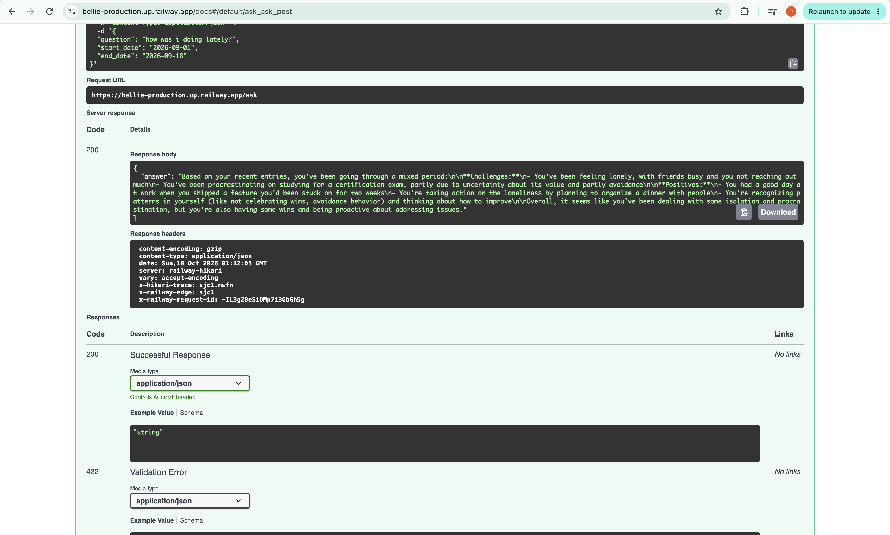

# Bellie Project

## To run 
1. source .venv/bin/activate
2. uvicorn main:app --reload

### Ingesting journal into DB 
1. Create the journal file 
2. Create a separate database for the journal in postgres 
```
createdb bellie_demo
psql bellie_demo

CREATE EXTENSION vector;
CREATE TABLE entries (
    id SERIAL PRIMARY KEY,
    entry_date DATE NOT NULL,
    content TEXT NOT NULL,
    embedding vector(1536)
);

\q
```
3. Point ingest.py at the new file and new database. 
```
DB_NAME=bellie_demo python3 -c "
from parser import parse_journal
import ingest

with open('synthetic_journal.txt') as f:
    raw = f.read()

entries = parse_journal(raw, year=2026)
print(f'Parsed {len(entries)} synthetic entries')
"
```
4. Verify count 
psql bellie_demo
SELECT COUNT(*) FROM entries;


# Railway 
## Deploying Bellie to Railway

https://bellie-production.up.railway.app/health
https://bellie-production.up.railway.app/docs#

### Prerequisites (one-time)
- `brew install railway`
- `railway login`
- Code pushed to GitHub
- `Procfile` present in the repo root:
web: uvicorn main:app --host 0.0.0.0 --port $PORT


### 1. Create the project
- Go to [railway.app](https://railway.app) → **New Project** → **Deploy from GitHub repo** → select the repo

### 2. Add Postgres + enable pgvector
```bash
railway service        # select "Postgres"
railway variables       # copy the DATABASE_URL value shown — you'll need it in step 4
railway connect Postgres
```
> First time connecting may require an SSH key: `ssh-keygen -t ed25519` (press Enter to accept the default path `~/.ssh/id_ed25519` — don't rename it)

Inside the `psql` session that opens:
```sql
CREATE EXTENSION vector;

CREATE TABLE entries (
    id SERIAL PRIMARY KEY,
    entry_date DATE NOT NULL,
    content TEXT NOT NULL,
    embedding vector(1536)
);

\q
```

### 3. Switch the CLI to the app service
```bash
railway service        # select "Bellie" (not Postgres) — all remaining commands target this
```

### 4. Set environment variables

> ⚠️ Railway's UI suggests referencing `${{Postgres.DATABASE_PRIVATE_URL}}` — **this does not work**, that variable doesn't exist on the Postgres service. Use the literal `DATABASE_URL` string copied in step 2 instead.

```bash
railway variables --set "DATABASE_URL=<paste the connection string from step 2>"
railway variables --set "OPENAI_API_KEY=..."
railway variables --set "ANTHROPIC_API_KEY=..."
railway variables --set "EMBEDDING_MODEL=text-embedding-3-small"
railway variables --set "CLAUDE_MODEL=claude-sonnet-4-5"
railway variables --set "MAX_TOKENS=500"
railway variables --set "BELLIE_API_KEY=..."
```
Verify with `railway variables` — values should show as real strings, not empty.

### 5. Deploy
```bash
railway up
```

### 6. Ingest synthetic data

> ⚠️ `ingest.py` **cannot** be run from your laptop against Railway's database — `postgres.railway.internal` only resolves inside Railway's private network. Use `railway ssh` to run it from inside that network instead:

```bash
railway ssh
```
Then, inside that shell (now running on Railway):
```bash
JOURNAL_FILE=synthetic_journal.txt python3 ingest.py
```

### 7. Test
- Get the public URL from the app service's **Settings → Networking** (generate a domain if none exists)
```bash
curl https://YOUR-URL.up.railway.app/health
# expect: {"status":"ok"}
```
- Test `/ask` via `https://YOUR-URL.up.railway.app/docs` → click **Authorize**, paste `BELLIE_API_KEY` → try a question



### 8. Tear down when done (to stop all cost)
Project **Settings → Danger Zone → Delete Project**. This removes the app + database together. Code stays safe in GitHub — redeploy anytime by repeating this runbook.